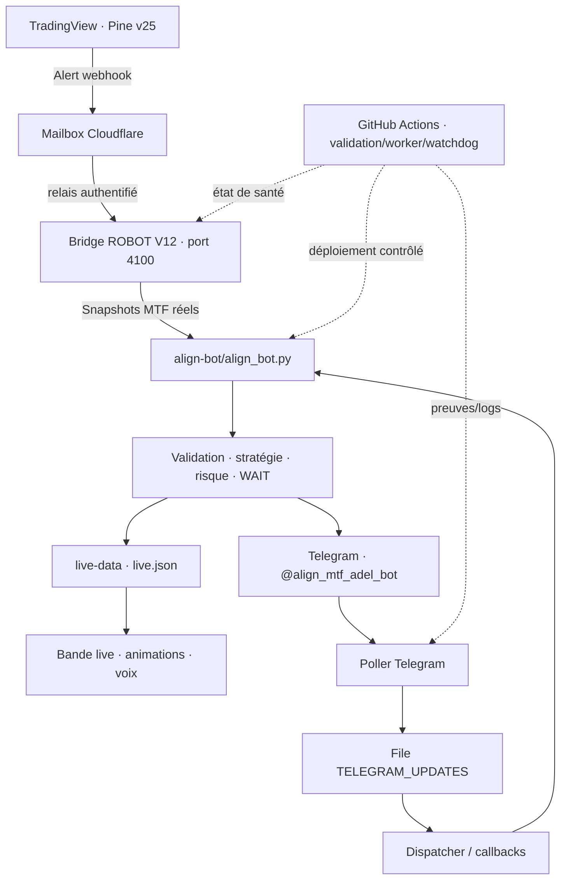

# ALIGN — carte du système et règles de fiabilité

> Document de repérage. La source de vérité reste `docs/ALIGN_SOURCE_DE_VERITE.md`.
> Aucun code de production, secret, branche live ou workflow n'est modifié par ce document.

## 1. Une chaîne runtime

## 2. Responsabilité par composant

| Composant | Responsabilité unique | Échec sûr attendu |
|---|---|---|
| Pine v25 | Calculer signal, plan M15, déclencheur et snapshots UT | Pas de payload incomplet présenté comme valide |
| Mailbox Cloudflare | Transport des alertes | Refuser authentification invalide et payload malformé |
| Bridge ROBOT V12 | Valider symbole, timestamps, MTF, déclencheur; conserver snapshots valides | Refuser/downgrader un plan invalide; aucune fabrication |
| Bot `align_bot.py` | Analyse, règles, mémoire, commandes et orchestration | `WAIT` si données/prérequis insuffisants |
| Poller Telegram | Recevoir updates, préserver offset, acquitter sans perdre la file | Pas d'ACK interprété comme action exécutée |
| Dispatcher | Router commandes/callbacks vers handlers | Callback inconnu, duplicata ou non autorisé traité explicitement |
| Publication live-data | Publier état public `live.json` | Ne jamais exposer secrets/données privées |
| Bande live | Affichage, animations, narration | L'état absent ne doit pas être remplacé par un état inventé |
| Worker/watchdog | Démarrage, relève, arrêt propre, sauvegarde mémoire | Un worker actif ne s'arrête que si son remplaçant réel est confirmé |

## 3. Source de vérité — fichiers principaux

- `align-bot/pine/ALIGN_MTF_PRO_V25.pine` : indicateur actif.
- `align-bot/align_tv_bridge.py` : contrat et stockage snapshots bridge.
- `align-bot/align_tv_mailbox_feeder.py` : relais mailbox.
- `align-bot/align_bot.py` : bot, traitement et commandes.
- `.github/workflows/align-bot-validation.yml` : validation réutilisable.
- `.github/workflows/align-bot.yml` : worker production.
- `.github/workflows/align-bot-rollover.yml` : retrait contrôlé d'ancien worker.
- `.github/workflows/align-workflow-watchdog.yml` + `scripts/align_workflow_watchdog.py` : surveillance et diagnostic.
- `docs/live/align-bande-live.user.js` : bande TradingView et animations.
- `live-data/live.json` : branche de publication uniquement; pas de code.

## 4. Dossiers : ce qu'on garde, ce qu'on clarifie, ce qu'on ne supprime pas encore

| Zone | Classe | Action |
|---|---|---|
| `align-bot/` | Runtime critique | Garder isolé; ne pas déplacer les tests sans mise à jour de leurs imports/workflows |
| `.github/workflows/` | CI, worker, supervision | Garder; chaque workflow doit avoir un rôle non chevauchant |
| `cloud/` | Mailbox/edge | Garder; vérifier contrats depuis tests |
| `docs/live/` | Assets live/public | Garder; préserver animations/design |
| `tradingview-analyzer/`, `src/`, `lib/`, `studio/`, `public/` | Extension/UI et outils | Pas de fusion/suppression avant cartographie des imports, scripts et builds |
| `agent-export/`, `analysis/`, `trading/`, `store/`, `utils/`, `tests/`, `bridge/` | Outils, données, archives ou sous-systèmes potentiellement historiques | Identifier références et usages; déplacer seulement avec tests de liens/consommateurs |
| Documentation historique à la racine | Redondance/ambiguïté | Ne pas supprimer en masse; indexer puis archiver après preuve de non-référence |

**Constat de nettoyage :** la racine contient beaucoup de rapports, plans et documents de session en doublon. Ils encombrent l'orientation mais ne prouvent pas que les dossiers de code sont inutiles. Le nettoyage doit commencer par la documentation, l'indexation et l'analyse des dépendances, pas par une suppression aveugle.

## 5. Boucle de fiabilité

1. **Identifier** : dépôt, branche, SHA, worker/run et PR.
2. **Valider** : compile Python, JS, actionlint, contrats bridge, tests MTF et callbacks.
3. **Préflight** : identité Telegram attendue, mode de réception, IA, bridge BTC/GOLD, snapshots et timestamps.
4. **Démarrer** : worker sur le SHA validé seulement.
5. **Vérifier** : poller reçoit; callback est dispatché; handler finit; réponse Telegram réellement livrée; publication live confirmée.
6. **Surveiller** : heartbeat et métriques; alertes sur worker absent, queue en hausse, erreurs API, données périmées.
7. **Récupérer** : un seul worker; arrêt propre + mémoire sauvegardée; remplaçant confirmé actif avant de considérer la relève réussie.
8. **Clore** : preuve positive fraîche de chaque maillon; sinon statut explicite `NOT VERIFIED`.

## 6. Définition du « 100 % »

Le 100 % signifie **100 % des contrôles définis passent sur le SHA concerné et les tests d'intégration live autorisés sont positifs**. Cela ne veut pas dire que les marchés, les fournisseurs IA ou Telegram ne peuvent jamais tomber en panne. Le système doit être fiable par détection, échec sûr et reprise vérifiée.

- Aucun ordre broker réel.
- Aucun merge/déploiement sans approbation explicite.
- Aucune suppression de fichier, branche, PR ou donnée dont l'utilité/provenance n'est pas établie.
- CI verte seule n'est pas une preuve de fonctionnement live.

